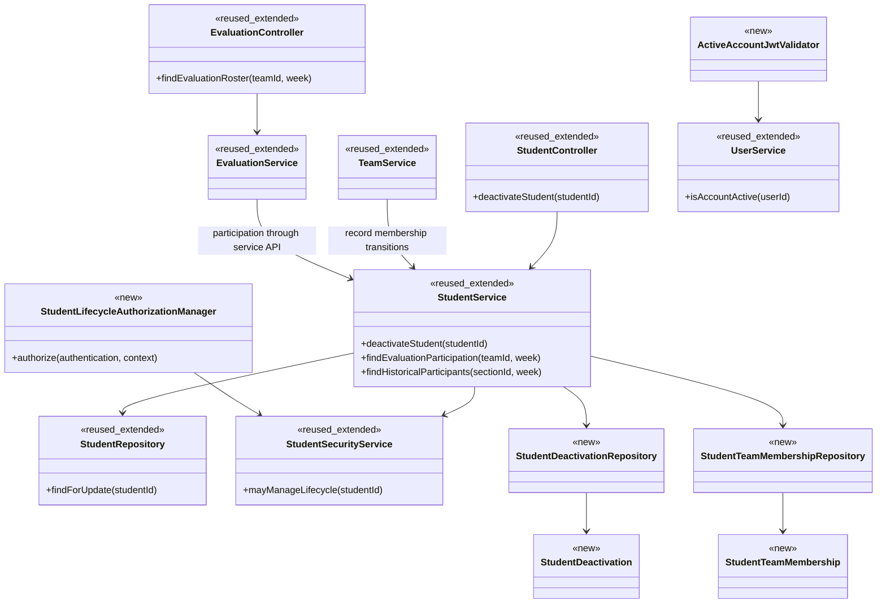
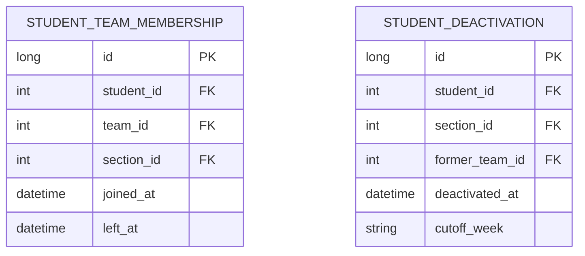

# Student Design

> Realizes: [UC-STU-deactivate-student](../requirements/use-cases.md#uc-stu-deactivate-student-the-course-admininstructor-deactivates-a-student).
> Depends on FRs: FR-SEC-authentication, FR-SEC-authorization, FR-SEC-deny-unauthorized, FR-SEC-active-account in the [SRS](../requirements/software-requirements-specification.md).
> Governing rules: BR-student-lifecycle, BR-section-scoped-access, BR-team-admin-only, BR-submission-owed, BR-evaluation-submission-window, BR-evaluation-editable-until-close in [business rules](../requirements/business-rules.md).
> Status: proposed design-of-record; conversation acceptance permits writing, but independent review and merge remain the design gate. No implementation is claimed.

## Overview

Extend the existing student vertical slice inside the [architecture-of-record](architectural-design.md#building-block-view). This first STU design covers deactivation and the evaluation/report consequences it introduces, not every existing student use case. Inherit the [architectural conventions](architectural-design.md#architectural-conventions), security mechanisms, transaction boundaries, and calendar clock. The requirements own behavior; this document fixes responsibilities and contracts.

## Components & classes



Paths below are relative to the repository root:

| Surface | Reuse / change |
|---|---|
| [StudentController](../../backend/src/main/java/team/projectpulse/student/StudentController.java), [StudentService](../../backend/src/main/java/team/projectpulse/student/StudentService.java), [StudentRepository](../../backend/src/main/java/team/projectpulse/student/StudentRepository.java), [Student](../../backend/src/main/java/team/projectpulse/student/Student.java) | Extend controller/service/repository; retain the existing account and optional team association. |
| [StudentSecurityService](../../backend/src/main/java/team/projectpulse/student/StudentSecurityService.java) | Add lifecycle predicate; reuse scoped relationship lookups. |
| `security/authorizationmanagers/StudentLifecycleAuthorizationManager.java` | New manager; no self-access branch. |
| `student/StudentDeactivation*`, `student/StudentTeamMembership*` | New persistent departure and membership history, owned by student service. |
| [TeamService](../../backend/src/main/java/team/projectpulse/team/TeamService.java) | Assignment, reassignment, and removal maintain membership intervals through StudentService in the same transaction. |
| [EvaluationController](../../backend/src/main/java/team/projectpulse/evaluation/EvaluationController.java), [EvaluationService](../../backend/src/main/java/team/projectpulse/evaluation/EvaluationService.java) | Add roster query; share eligibility for create/update and historical report selection. Do not access student history repositories directly. |
| [SecurityConfiguration](../../backend/src/main/java/team/projectpulse/security/SecurityConfiguration.java), [UserService](../../backend/src/main/java/team/projectpulse/user/UserService.java) | Wire new route manager and active-account JWT validator; retain existing login checks. |
| [Students.vue](../../frontend/src/pages/students/Students.vue), [EditStudentForm.vue](../../frontend/src/pages/students/EditStudentForm.vue), [student API](../../frontend/src/apis/student/index.ts) | Explicit deactivate action with consequence confirmation; separate from profile save. |
| [SubmitTeamsEvaluations.vue](../../frontend/src/pages/evaluations/SubmitTeamsEvaluations.vue), [SectionsEvaluations.vue](../../frontend/src/pages/evaluations/admin/SectionsEvaluations.vue) | Consume eligibility independently of active status; preserve previous-week controls and historical details. |

## Sequence

### UC-STU-deactivate-student

```mermaid
sequenceDiagram
    actor I as Course admin / instructor
    participant UI as Student editor
    participant Security as Security filter chain
    participant Guard as StudentLifecycleAuthorizationManager
    participant C as StudentController
    participant S as StudentService
    participant DB as Database
    I->>UI: Open student details (steps 1-2)
    UI->>C: Existing GET student (step 2; existing security applies)
    C-->>UI: StudentDto (step 2)
    UI-->>I: Details and deactivate action (step 2)
    I->>UI: Choose deactivate (step 3)
    UI-->>I: Consequences and confirmation (step 4)
    alt Cancel or dismiss (4a)
        UI-->>I: End without mutation request
    else Confirm (step 5)
        I->>UI: Confirm deactivation
        UI->>Security: PATCH student deactivation (step 6)
        Security->>Security: JWT signature/time and current account check
        Security->>Guard: Authorize named student
        alt Caller outside lifecycle scope (3a)
            Guard-->>Security: Deny
            Security-->>UI: 403; no changes
        else Allowed
            Guard-->>Security: Allow
            Security->>C: Dispatch
            C->>S: deactivateStudent(studentId)
            S->>DB: Lock target; recheck caller scope
            alt Already inactive (6b)
                S-->>C: Conflict; no changes
                C-->>UI: 409; already deactivated
            else Active
                S->>DB: Record deactivation time and former team
                opt Assigned to team (6a)
                    S->>DB: Close membership interval; clear current team
                end
                S->>DB: Set enabled=false; commit atomically
                S-->>C: Updated student
                C-->>UI: Success Result with StudentDto
                UI-->>I: Deactivated; refresh displayed status (steps 6-7)
            end
        end
    end
```

### Previous-week evaluation after deactivation

This realizes the deactivation UC's Associated Information and the amended EVA submission flow.

```mermaid
sequenceDiagram
    actor T as Former teammate
    participant UI as Evaluation entry
    participant E as EvaluationService
    participant S as StudentService
    participant DB as Database
    T->>UI: Open evaluation entry for previous week
    UI->>E: Request authorized team roster and evaluated week
    E->>S: Resolve participation and departure cutoff
    S->>DB: Read membership intervals and deactivation history
    S-->>E: Former student with active=false and evaluationAllowed=true
    E-->>UI: Roster including former student
    T->>UI: Submit or edit previous-week evaluation
    UI->>E: Existing create/update request
    E->>S: Recheck eligibility at submission time
    E->>E: Apply existing active-week and open-window checks
    E->>DB: Save evaluation
    E-->>UI: Existing success Result
    Note over E,DB: Deactivation-week and later entry is disabled; retained records remain readable
```

## API contract

All paths have the `/api/v1` prefix. All errors use the existing Result envelope and matching StatusCode. Authentication errors use existing security handlers. Field types and JSON serialization are implementation details.

| Endpoint | Caller | Request | Success | Errors / extensions |
|---|---|---|---|---|
| New `PATCH /students/{studentId}/deactivation` | Owning course admin or instructor assigned to student's course section | No body; no caller-supplied team, time, or week | 200, updated StudentDto; includes enabled=false and empty team assignment | 401 unauthenticated/disabled caller; 403 outside scope or unresolved target (3a); 409 already inactive (6b). No request for cancellation (4a). |
| Existing `PUT /students/{studentId}` | Existing profile-update callers, with lifecycle permission required for attempted deactivation | Existing StudentDto | Existing profile-update response when no deactivation attempted | Unauthorized lifecycle attempt: 403. Authorized active-to-inactive attempt: 400 / INVALID_ARGUMENT, “Student deactivation requires the deactivation endpoint. No changes were saved.” Reject entire update before profile fields are saved. |
| New `GET /evaluations/teams/{teamId}/roster?week=...` | Current team member, assigned course section instructor, or owning course admin | Team and evaluated week | 200, entries with student identity/name, active status, participation, evaluationAllowed; include relevant inactive former members | 401 anonymous/disabled; 403 outside team/course-section scope or unknown team; 400 invalid week. Do not expose evaluation scores/private comments through this roster. |
| Existing `POST /evaluations`, `PUT /evaluations/{evaluationId}` | Authorized active evaluator | Existing evaluation DTO | Existing Result | Existing 400 window/validation errors; 400 for ineligible evaluatee/week. Check stored target and week on updates; request fields cannot retarget an existing evaluation. |
| Existing `GET /evaluations/sections/{sectionId}/week/{week}` | Assigned instructor or owning course admin | Existing path arguments | Existing report with historical participants, even without evaluations | Existing errors; 401/403 for authentication/scope. Empty results must not synthesize evaluation records. |
| Existing `GET /evaluations/students/{studentId}/week/{week}/details` | Assigned instructor or owning course admin | Existing path arguments | Existing details, including retained deactivation-week records | Existing errors; current team removal does not prohibit authorized historical access. |

### SecurityConfiguration rules

Register the new mutation explicitly before the API deny-all fallback:

```java
.requestMatchers(HttpMethod.PATCH, this.baseUrl + "/students/{studentId}/deactivation")
.access(this.studentLifecycleAuthorizationManager)
```

The manager parses `studentId` with existing PathVariables and delegates to StudentSecurityService. Its predicate is `(instructor role AND assigned to target course section) OR (admin role AND owns target course)`. Missing/malformed targets fail closed. The transaction rechecks scope on the locked record before mutation. Never reuse UserOwnershipAuthorizationManager: it permits self access. StudentInstructorAuthorizationManager alone omits explicit course ownership.

Register `GET /evaluations/teams/{teamId}/roster` with the existing team-membership manager, extending its owning-course-admin coverage if needed. Ensure report/detail route managers likewise admit both specified instructor groups. An unrelated admin has no global override.

## Key decisions

- **Dedicated mutation instead of profile toggle.** No-body PATCH changes only lifecycle state. Reject generic PUT deactivation rather than silently bypassing confirmation-oriented workflow, history capture, or permission checks. The API cannot prove a human read a dialog; confirmation is a frontend responsibility, while authorization and invariants are server responsibilities.
- **Transaction and target lock instead of independent saves.** Scope/state checks, departure capture, membership close, and enabled=false are one service transaction. Lock the target so concurrent requests yield one success and one 409. On failure all changes roll back. Serialize assignment/removal against that same target lock to keep captured history consistent.
- **Eligibility differs from account status.** An inactive former evaluatee remains eligible for the immediately preceding week until its ordinary close. Rejected: disabling all inactive rows, which would override the agreed previous-week exception. Deactivated evaluators themselves still cannot access protected resources.
- **Participation instead of existence of evaluations determines report rows.** Consult historical membership for the evaluated week; evaluation records determine available results. Rejected: current-team-only selection and evaluation-only selection, both of which lose required historical rows. Keep stored deactivation-week evaluations visible even though new entry for that week is unavailable.
- **Membership intervals plus immutable departures instead of a last-team field.** Record assignments/removals, not just the final departure. A single former team or timestamp cannot establish historical participation across reassignment or repeated deactivation. No general event-sourcing subsystem is introduced.
- **Shared JWT status validation instead of controller-specific guards or expiry waiting.** Compose ActiveAccountJwtValidator with the existing signature/time validators; lookup current account by userId through UserService. Missing or disabled accounts fail authentication; infrastructure lookup failure must not authorize a request. Do not replace standard token validators. The check denies subsequent requests; it does not retroactively cancel work already authorized in flight.
- **Existing submission accounting instead of a second owed definition.** BR-submission-owed continues to exclude inactive students and inactive former evaluatees from obligations. Permitted previous-week evaluation does not make it owed again. No new reminders or deactivation email are introduced.

## Data model

Cite the [SRS business domain model](../requirements/software-requirements-specification.md#business-domain-model); the diagram below contains only the implementation delta. Add the next available Flyway migration; do not edit old migrations.



Membership intervals are half-open: joined_at inclusive, left_at exclusive; null left_at means current membership. A participant's interval intersects the requested ISO week's date range. Membership maintenance must cover assignment, reassignment, removal, and deactivation; reactivation does not erase history. Store a departure even for a student without a team (former_team_id nullable). Deactivation history is append-only across repeated lifecycle transitions, not overwritten by reactivation.

Use the injected application Clock and WeekKeys for calendar time/cutoffs, including year boundaries. For the previous-week exception, resolve former team participation at departure and membership in the evaluated week; do not admit an unrelated evaluator. Preserve all previously submitted evaluation rows; deactivation never cascades deletion into work/history.

## Reuse & cross-cutting

Reuse the Result/error handlers, DTO converters, UserUtils, role/scope managers, BCrypt/login mechanism, WeekKeys and profile clocks, Flyway, and notification submission-status logic. This design does not introduce document locks, email workflows, or a second authentication system.

The shared active-account validator changes the architecture-of-record's Authentication description: after normal JWT verification, current account status is checked before protected access. This is a platform convention delta for independent review; that document still describes existing behavior and is not silently rewritten by this STU draft. Existing JWT-revocation debt is broader than inactive-account denial and must not be marked resolved wholesale.

## Tests

| Flow / requirement | Level | Assertions |
|---|---|---|
| Main success | Integration | Owning admin and assigned instructor each succeed; identity, course section, authored work and evaluation records survive. |
| No team | Integration | Deactivation succeeds with no team; access disabled, work retained, nullable former-team departure recorded. |
| 3a | Integration | Other-course admin, unassigned instructor, unrelated student and self receive 403; account/team/history unchanged. |
| 4a | Frontend interaction | Warning contains documented consequences; cancel and dismiss send no mutation request; confirm sends dedicated PATCH. |
| 6a | Integration | Current team cleared and membership interval closed atomically; history is queryable after removal. |
| 6b | Integration | Inactive target returns 409; concurrent deactivations yield one success and one conflict with one departure. |
| Atomic failure | Integration | Persistence failure rolls back enabled, team and history together. |
| Generic PUT bypass | Integration | Authorized transition attempt returns 400 / INVALID_ARGUMENT with no profile changes; unauthorized attempt returns 403. |
| FR-SEC-active-account | Integration, real issued token | Login then deactivate; original JWT denied on protected reads, WAR and evaluation submissions; new login denied. Missing account denied; valid active account unaffected. |
| Roster authorization | Integration | Own-team student, assigned instructor and owning admin admitted; unrelated student/instructor/admin denied with 403; anonymous gets 401. |
| Previous-week create/edit | Integration | Former teammate may create and edit until normal close despite evaluatee removal; after close both fail. Preserve active-week checks and year-boundary correctness. |
| Future entry | Integration + frontend interaction | Inactive former name remains visible but has no entry controls for cutoff/later weeks; direct create/update rejected. Previous-week controls stay available while eligible. |
| Historical report with evaluations | Integration | Prior results and details remain visible despite disabled account and null current team; deactivation-week stored results also survive. |
| Historical report without evaluations | Integration | Membership in evaluated week produces a row even without evaluations; no fabricated evaluation/score; no row based merely on current membership in an unrelated historical week. |
| Owed / reminders | Integration | Inactive student neither listed as owing nor reminded; optional previous-week evaluation of her does not reintroduce an obligation. |
| Reassignment / repeated lifecycle | Integration | Membership and departure records survive team changes and multiple deactivate/reactivate cycles; no previous history overwritten. |
| Scope/eligibility race | Integration | Assignment/removal concurrent with deactivation cannot capture an inconsistent team; submission checks current persisted eligibility. |

## Open questions / risks

- **Legacy history cannot be invented.** Current schema has no reliable assignment/departure dates. Backfill only evidenced history; seed current memberships at a documented migration boundary. Full historical rows for legacy weeks with no evaluation or membership evidence require an authoritative import before claiming that behavior verified. Current membership is not proof of past participation.
- **Historical null scores.** The requirement separates row inclusion from available results; implementation must not fabricate a zero grade for no evaluations. Exact empty-state wording is a UI detail.
- **Repeated lifecycle semantics.** Preserve every departure and membership interval. Historical report inclusion must remain stable after reactivation. This design does not redesign the reactivation use case or permit a generic PUT to bypass deactivation.
- **Review gate.** Architecture authentication delta and the membership-history expansion require reviewer attention. A fresh independent questions test and merged PR are still required before implementation. User retains commit responsibility.
